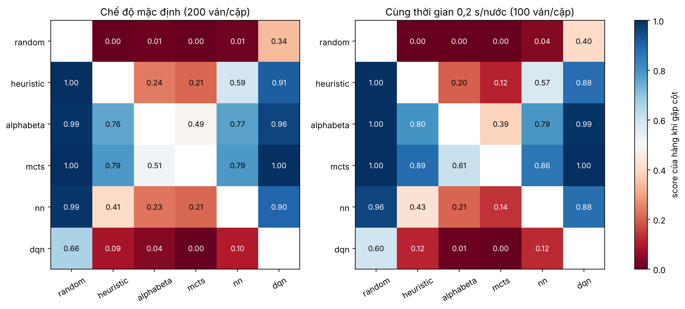
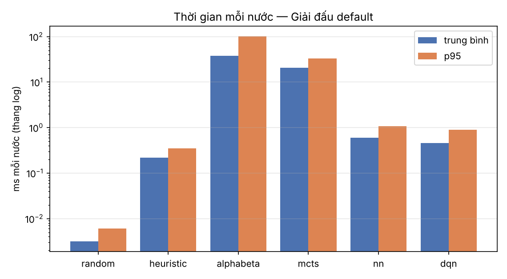
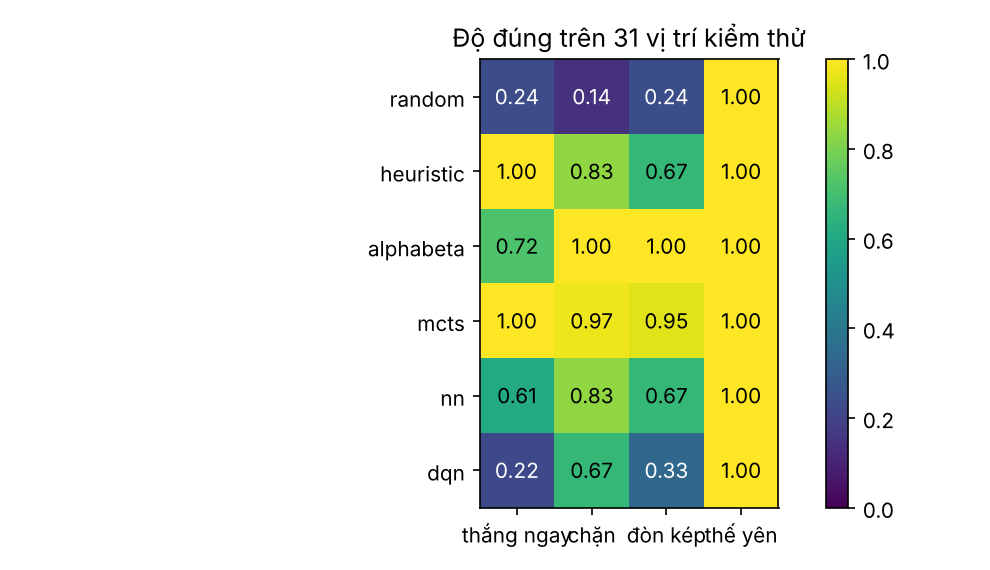

# 4.1–4.3. Kết quả giải đấu Round-Robin

> Mọi số trong mục này có dòng tương ứng trong `results/tables/report_numbers.csv`
> (mục `4.1`–`4.3`) và truy được tới log thô `results/logs/games_*.csv`, `moves_*.csv` qua `run_id`.
> Dữ liệu chạy ngày 18/11/2026. Ablation A1/A2/A5 xem [mục 4.5 – tìm kiếm](04d_ablation_tim_kiem.md), A3 xem [mục 4.5 – CNN](04e_ablation_cnn.md), A4 xem [mục 4.5 – DQN](04f_ablation_dqn.md).

## 4.1. Thiết lập

- 6 tác tử: Random, Heuristic, Alpha-Beta (độ sâu 5), MCTS (1.000 mô phỏng), CNN `nn` (cấp 5), DQN `dqn` (cấp 6).
- Round-Robin 15 cặp, mỗi cặp đổi bên, các cặp dùng chung khai cuộc ngẫu nhiên 4 nước; điểm = (W + 0,5·D)/N, khoảng tin cậy Wilson 95%.
- **Chế độ mặc định:** 200 ván/cặp (3.000 ván), seed 20261118, `run_id` tiền tố `tournament-default-20261118T163224Z-s20261118`.
- **Chế độ cùng thời gian:** 0,2 giây/nước cho tác tử tìm kiếm, 100 ván/cặp (1.500 ván), seed 20261119, tiền tố `tournament-timed-20261118T164206Z-s20261119`.
- Checkpoint CNN và DQN là bản đã đóng băng (xem 4.4). Seed giải đấu khác seed validation (20261102/20261103).
- Máy 2 nhân CPU, `OMP_NUM_THREADS=1`; mỗi giải chạy một mình trên máy (không chạy song song với huấn luyện) để số đo thời gian có ý nghĩa. Bước tổng hợp `summarize_tournament.py` của giải mặc định được chạy trong vài giây đầu của giải thời gian; độ trễ vẫn nằm trong cùng thang đo.

## 4.2. Kết quả đối đầu

### Chế độ mặc định

<!-- TABLE:default_matrix -->
| score của hàng khi gặp cột | random | heuristic | alphabeta | mcts | nn | dqn |
| --- | ---: | ---: | ---: | ---: | ---: | ---: |
| **random** | — | 0,00 | 0,01 | 0,00 | 0,01 | 0,34 |
| **heuristic** | 1,00 | — | 0,24 | 0,21 | 0,59 | 0,91 |
| **alphabeta** | 0,99 | 0,76 | — | 0,49 | 0,77 | 0,96 |
| **mcts** | 1,00 | 0,79 | 0,51 | — | 0,79 | 1,00 |
| **nn** | 0,99 | 0,41 | 0,23 | 0,21 | — | 0,90 |
| **dqn** | 0,66 | 0,09 | 0,04 | 0,00 | 0,10 | — |
<!-- /TABLE:default_matrix -->

<!-- TABLE:default_pairs -->
| Cặp (A – B) | Số ván | A thắng–hòa–B thắng | score của A | Wilson 95% |
| --- | ---: | ---: | ---: | ---: |
| alphabeta – dqn | 200 | 192–0–8 | 0,96 | [0,92; 0,98] |
| alphabeta – mcts | 200 | 96–3–101 | 0,49 | [0,42; 0,56] |
| alphabeta – nn | 200 | 150–7–43 | 0,77 | [0,70; 0,82] |
| heuristic – alphabeta | 200 | 47–2–151 | 0,24 | [0,19; 0,30] |
| heuristic – dqn | 200 | 182–1–17 | 0,91 | [0,87; 0,94] |
| heuristic – mcts | 200 | 39–7–154 | 0,21 | [0,16; 0,27] |
| heuristic – nn | 200 | 114–10–76 | 0,59 | [0,53; 0,66] |
| mcts – dqn | 200 | 199–1–0 | 1,00 | [0,98; 1,00] |
| mcts – nn | 200 | 154–7–39 | 0,79 | [0,73; 0,84] |
| nn – dqn | 200 | 178–2–20 | 0,90 | [0,84; 0,93] |
| random – alphabeta | 200 | 2–0–198 | 0,01 | [0,00; 0,04] |
| random – dqn | 200 | 68–1–131 | 0,34 | [0,28; 0,41] |
| random – heuristic | 200 | 0–0–200 | 0,00 | [0,00; 0,02] |
| random – mcts | 200 | 0–0–200 | 0,00 | [0,00; 0,02] |
| random – nn | 200 | 2–1–197 | 0,01 | [0,00; 0,04] |
<!-- /TABLE:default_pairs -->

### Chế độ cùng thời gian

<!-- TABLE:timed_matrix -->
| score của hàng khi gặp cột | random | heuristic | alphabeta | mcts | nn | dqn |
| --- | ---: | ---: | ---: | ---: | ---: | ---: |
| **random** | — | 0,00 | 0,00 | 0,00 | 0,04 | 0,40 |
| **heuristic** | 1,00 | — | 0,20 | 0,12 | 0,57 | 0,88 |
| **alphabeta** | 1,00 | 0,80 | — | 0,39 | 0,79 | 0,99 |
| **mcts** | 1,00 | 0,89 | 0,61 | — | 0,86 | 1,00 |
| **nn** | 0,96 | 0,43 | 0,21 | 0,14 | — | 0,88 |
| **dqn** | 0,60 | 0,12 | 0,01 | 0,00 | 0,12 | — |
<!-- /TABLE:timed_matrix -->

<!-- TABLE:timed_pairs -->
| Cặp (A – B) | Số ván | A thắng–hòa–B thắng | score của A | Wilson 95% |
| --- | ---: | ---: | ---: | ---: |
| alphabeta – dqn | 100 | 99–0–1 | 0,99 | [0,95; 1,00] |
| alphabeta – mcts | 100 | 37–4–59 | 0,39 | [0,30; 0,49] |
| alphabeta – nn | 100 | 78–2–20 | 0,79 | [0,70; 0,86] |
| heuristic – alphabeta | 100 | 17–6–77 | 0,20 | [0,13; 0,29] |
| heuristic – dqn | 100 | 88–0–12 | 0,88 | [0,80; 0,93] |
| heuristic – mcts | 100 | 10–3–87 | 0,12 | [0,07; 0,19] |
| heuristic – nn | 100 | 56–3–41 | 0,57 | [0,48; 0,67] |
| mcts – dqn | 100 | 100–0–0 | 1,00 | [0,96; 1,00] |
| mcts – nn | 100 | 86–0–14 | 0,86 | [0,78; 0,91] |
| nn – dqn | 100 | 87–1–12 | 0,88 | [0,80; 0,93] |
| random – alphabeta | 100 | 0–0–100 | 0,00 | [0,00; 0,04] |
| random – dqn | 100 | 40–0–60 | 0,40 | [0,31; 0,50] |
| random – heuristic | 100 | 0–0–100 | 0,00 | [0,00; 0,04] |
| random – mcts | 100 | 0–0–100 | 0,00 | [0,00; 0,04] |
| random – nn | 100 | 4–0–96 | 0,04 | [0,02; 0,10] |
<!-- /TABLE:timed_pairs -->

### Nhận xét (chỉ dựa trên bảng trên)

- Xếp hạng score chung (mặc định): MCTS 0,817 > Alpha-Beta 0,793 > Heuristic 0,592 > CNN 0,546 > DQN 0,178 > Random 0,073. Chế độ cùng thời gian cho cùng thứ tự, với MCTS 0,871 và Alpha-Beta 0,794.
- MCTS và Alpha-Beta gần ngang nhau ở chế độ mặc định (Alpha-Beta đạt score 0,488 trước MCTS; khoảng tin cậy 0,419–0,556, chứa 0,5). Ở 0,2 giây/nước, Alpha-Beta thua MCTS (score 0,390 trên 100 ván, khoảng 0,300–0,488): mẫu nhỏ, nhưng khoảng không chứa 0,5.
- CNN thắng Random và kém Heuristic nhẹ: Heuristic thắng CNN với score 0,595 trong chế độ mặc định (khoảng 0,526–0,661, không chứa 0,5) và 0,575 trong chế độ cùng thời gian (0,477–0,667, chứa 0,5).
- **DQN yếu hơn Heuristic rõ rệt:** Heuristic thắng DQN với score 0,912 (mặc định) và 0,880 (cùng thời gian); DQN chỉ hơn Random (xem bảng cặp). Đây là kết quả của checkpoint đã đóng băng theo quy tắc validation đã đăng ký trước; không điều chỉnh sau khi thấy kết quả giải. Nguyên nhân được phân tích ở 4.4.
- Các kết luận ở trên chỉ áp dụng cho cấu hình, độ sâu, số mô phỏng và seed đã ghi; không suy ra cho cấu hình khác.

## 4.3. Chi phí tính toán

<!-- TABLE:default_latency -->
| Tác tử | Số ván | score chung | Wilson 95% | ms/nước (TB) | ms/nước (p95) | ms/nước (max) | nút/nước | mô phỏng/nước | ván vượt ngân sách |
| --- | ---: | ---: | ---: | ---: | ---: | ---: | ---: | ---: | ---: |
| random | 1000 | 0,07 | [0,06; 0,09] | 0,00 | 0,01 | 0,1 | — | — | — |
| heuristic | 1000 | 0,59 | [0,56; 0,62] | 0,22 | 0,35 | 7,3 | 5 | — | — |
| alphabeta | 1000 | 0,79 | [0,77; 0,82] | 38,11 | 100,60 | 339,3 | 1 542 | — | — |
| mcts | 1000 | 0,82 | [0,79; 0,84] | 20,74 | 32,80 | 178,0 | 784 | 1 000 | — |
| nn | 1000 | 0,55 | [0,52; 0,58] | 0,60 | 1,08 | 12,9 | — | — | — |
| dqn | 1000 | 0,18 | [0,16; 0,20] | 0,46 | 0,90 | 10,9 | — | — | — |
<!-- /TABLE:default_latency -->

<!-- TABLE:timed_latency -->
| Tác tử | Số ván | score chung | Wilson 95% | ms/nước (TB) | ms/nước (p95) | ms/nước (max) | nút/nước | mô phỏng/nước | ván có nước > 0,2 s |
| --- | ---: | ---: | ---: | ---: | ---: | ---: | ---: | ---: | ---: |
| random | 500 | 0,09 | [0,07; 0,12] | 0,00 | 0,01 | 0,1 | — | — | 0 |
| heuristic | 500 | 0,55 | [0,51; 0,60] | 0,23 | 0,36 | 5,9 | 5 | — | 0 |
| alphabeta | 500 | 0,79 | [0,76; 0,83] | 170,28 | 200,05 | 201,7 | 8 786 | — | 500 |
| mcts | 500 | 0,87 | [0,84; 0,90] | 206,02 | 222,30 | 525,2 | 5 263 | 15 948 | 500 |
| nn | 500 | 0,52 | [0,48; 0,57] | 0,68 | 1,27 | 10,3 | — | — | 0 |
| dqn | 500 | 0,17 | [0,14; 0,21] | 0,48 | 1,03 | 6,3 | — | — | 0 |
<!-- /TABLE:timed_latency -->

- Ở chế độ mặc định Alpha-Beta tốn trung bình 38 ms/nước (p95 ≈ 101 ms), MCTS ≈ 21 ms/nước với 1.000 mô phỏng; CNN, DQN và Heuristic dưới 1 ms.
- Ở chế độ cùng thời gian Alpha-Beta và MCTS dùng hết ngân sách ≈ 0,2 giây/nước (p95 xấp xỉ 200–222 ms), nên so sánh đối đầu ở chế độ này là so sánh **cùng ngân sách thời gian**, không cùng số nút.
- Số nút/mô phỏng và p95 ở các bảng trên được đo trong lúc máy không chạy tác vụ khác.

## 4.3b. Độ đúng chiến thuật trên 31 vị trí kiểm thử

Bộ `tests/data/positions.csv`: 18 thế thắng ngay, 6 thế phải chặn (3 thế đòn kép), 6 thế yên; 1 thế đã kết thúc bị bỏ qua. Random được lặp nhiều seed; các tác tử còn lại xác định nên chạy một lần.

<!-- TABLE:positions -->
| Tác tử | thắng ngay (n=18 thế) | chặn (n=6 thế) | đòn kép (tập con của chặn/thắng) (n=3 thế) | thế yên (chỉ cần hợp lệ) (n=6 thế) |
| --- | ---: | ---: | ---: | ---: |
| random | 0,24 (854/3600) | 0,14 (173/1200) | 0,24 (145/600) | 1,00 (1200/1200) |
| heuristic | 1,00 (360/360) | 0,83 (100/120) | 0,67 (40/60) | 1,00 (120/120) |
| alphabeta | 0,72 (130/180) | 1,00 (60/60) | 1,00 (30/30) | 1,00 (60/60) |
| mcts | 1,00 (360/360) | 0,97 (117/120) | 0,95 (57/60) | 1,00 (120/120) |
| nn | 0,61 (11/18) | 0,83 (5/6) | 0,67 (2/3) | 1,00 (6/6) |
| dqn | 0,22 (4/18) | 0,67 (4/6) | 0,33 (1/3) | 1,00 (6/6) |
<!-- /TABLE:positions -->

- Alpha-Beta (độ sâu 5, cấu hình mặc định) chọn sai ở **5/18** thế thắng ngay. Kiểm tra bằng `scripts/check_alphabeta_win_values.py` (`results/tables/y6_alphabeta_root_values.csv`): ở 3 trong 5 thế đó, một nước không thắng ngay được chấm điểm cao hơn nước thắng ngay. Đây là điểm yếu của hàm đánh giá/ước lượng giá trị gốc, **không phải lỗi của bộ chạy giải**; chưa sửa vì mã Alpha-Beta thuộc phần việc của Khang. Cần Khang xem lại trước khi chốt báo cáo (xem thêm 4.7.2).
- MCTS đạt ≥ 0,95 ở mọi loại thế quan trọng; DQN thấp nhất (thắng ngay 0,22; chặn 0,67).

## 4.1b. Lợi thế đi trước

<!-- TABLE:default_first_move -->
| Cặp | Số ván | Đi trước thắng–hòa–đi sau thắng | score của bên đi trước | Wilson 95% |
| --- | ---: | ---: | ---: | ---: |
| alphabeta – dqn | 200 | 100–0–100 | 0,50 | [0,43; 0,57] |
| alphabeta – mcts | 200 | 117–3–80 | 0,59 | [0,52; 0,66] |
| alphabeta – nn | 200 | 105–7–88 | 0,54 | [0,47; 0,61] |
| heuristic – alphabeta | 200 | 107–2–91 | 0,54 | [0,47; 0,61] |
| heuristic – dqn | 200 | 95–1–104 | 0,48 | [0,41; 0,55] |
| heuristic – mcts | 200 | 114–7–79 | 0,59 | [0,52; 0,65] |
| heuristic – nn | 200 | 105–10–85 | 0,55 | [0,48; 0,62] |
| mcts – dqn | 200 | 99–1–100 | 0,50 | [0,43; 0,57] |
| mcts – nn | 200 | 103–7–90 | 0,53 | [0,46; 0,60] |
| nn – dqn | 200 | 100–2–98 | 0,51 | [0,44; 0,57] |
| random – alphabeta | 200 | 100–0–100 | 0,50 | [0,43; 0,57] |
| random – dqn | 200 | 101–1–98 | 0,51 | [0,44; 0,58] |
| random – heuristic | 200 | 100–0–100 | 0,50 | [0,43; 0,57] |
| random – mcts | 200 | 100–0–100 | 0,50 | [0,43; 0,57] |
| random – nn | 200 | 99–1–100 | 0,50 | [0,43; 0,57] |
| **tất cả các cặp** | 3000 | 1545–42–1413 | 0,52 | [0,50; 0,54] |
<!-- /TABLE:default_first_move -->

<!-- TABLE:timed_first_move -->
| Cặp | Số ván | Đi trước thắng–hòa–đi sau thắng | score của bên đi trước | Wilson 95% |
| --- | ---: | ---: | ---: | ---: |
| alphabeta – dqn | 100 | 49–0–51 | 0,49 | [0,39; 0,59] |
| alphabeta – mcts | 100 | 44–4–52 | 0,46 | [0,37; 0,56] |
| alphabeta – nn | 100 | 53–2–45 | 0,54 | [0,44; 0,63] |
| heuristic – alphabeta | 100 | 50–6–44 | 0,53 | [0,43; 0,62] |
| heuristic – dqn | 100 | 46–0–54 | 0,46 | [0,37; 0,56] |
| heuristic – mcts | 100 | 51–3–46 | 0,53 | [0,43; 0,62] |
| heuristic – nn | 100 | 55–3–42 | 0,56 | [0,47; 0,66] |
| mcts – dqn | 100 | 50–0–50 | 0,50 | [0,40; 0,60] |
| mcts – nn | 100 | 58–0–42 | 0,58 | [0,48; 0,67] |
| nn – dqn | 100 | 51–1–48 | 0,52 | [0,42; 0,61] |
| random – alphabeta | 100 | 50–0–50 | 0,50 | [0,40; 0,60] |
| random – dqn | 100 | 52–0–48 | 0,52 | [0,42; 0,62] |
| random – heuristic | 100 | 50–0–50 | 0,50 | [0,40; 0,60] |
| random – mcts | 100 | 50–0–50 | 0,50 | [0,40; 0,60] |
| random – nn | 100 | 52–0–48 | 0,52 | [0,42; 0,62] |
| **tất cả các cặp** | 1500 | 761–19–720 | 0,51 | [0,49; 0,54] |
<!-- /TABLE:timed_first_move -->

Toàn giải, bên đi trước đạt score 0,522 (khoảng 0,504–0,540) ở chế độ mặc định và 0,514 (0,488–0,539) ở chế độ cùng thời gian. Diễn giải xem [mục 4.7](04h_thao_luan.md).

## Giới hạn

Một bộ seed cho mỗi chế độ; khoảng Wilson tính theo ván, các ván cùng khai cuộc không hoàn toàn độc lập. Kết quả ở chế độ cùng thời gian phụ thuộc vào máy (2 nhân CPU).
