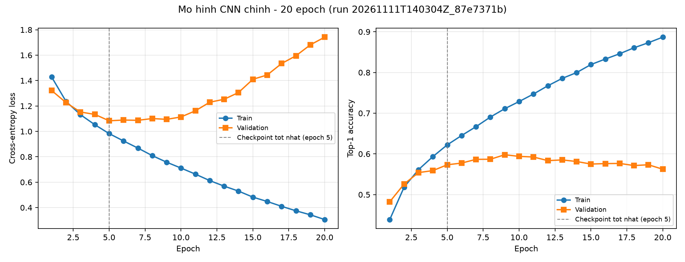
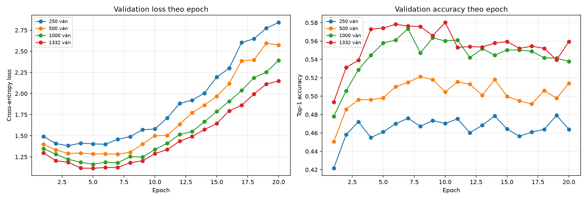

# 4.4. Đường cong học của CNN

> **Trạng thái số liệu (bản nháp).** Mục này dùng bộ log huấn luyện ngày
> 11/11/2026. Theo Issue #41, số liệu cuối phải lấy từ bộ đóng băng
> 19/11/2026 22:00; trước khi merge cần đối chiếu lại và cập nhật
> `results/tables/report_numbers.csv` nếu bộ đóng băng thay đổi. Mọi số dưới
> đây đã được kiểm tra với log và metadata hiện có, không có số ước lượng.

Mục này đọc đường cong học của mạng CNN Policy ở cấp 5: loss và accuracy trên
tập train so với validation qua từng epoch. Đường cong trả lời hai câu hỏi:

1. Mô hình có thực sự học được tín hiệu từ dữ liệu không?
2. Mô hình bắt đầu quá khớp từ epoch nào, và checkpoint được chọn ở đâu?

## 4.4.1. Cách đọc đường cong

Với mỗi epoch, chương trình huấn luyện ghi bốn chỉ số vào
`train_cnn_<run_id>.csv`:

- `train_loss`, `val_loss`: cross-entropy trung bình trên tập train và
  validation;
- `train_accuracy`, `val_accuracy`: tỷ lệ dự đoán đúng nhãn Alpha-Beta (top-1).

Cách đọc cơ bản:

- **Giai đoạn học:** cả train loss và validation loss cùng giảm. Đây là lúc mô
  hình tiếp nhận tín hiệu từ dữ liệu.
- **Giai đoạn quá khớp:** train loss tiếp tục giảm nhưng validation loss tăng
  trở lại. Khoảng cách giữa train accuracy và validation accuracy nới rộng.
- **Checkpoint:** mô hình được chọn theo **validation loss thấp nhất**, không
  theo train loss và không theo validation accuracy. Lý do được phân tích ở
  mục 4.4.2.

Khoảng cách quá khớp được đo bằng:

```text
gap_accuracy(epoch) = train_accuracy(epoch) − val_accuracy(epoch)
```

Chỉ số này chỉ dùng để chẩn đoán, không phải thước đo sức mạnh thi đấu.

## 4.4.2. Đường cong của mô hình chính

Mô hình chính dùng cohort `main_model`, huấn luyện 20 epoch với seed 0. Bảng
dưới trích sáu epoch đại diện; toàn bộ 20 epoch nằm trong
`checkpoints/logs/train_cnn_20261111T140304Z_87e7371b.csv`.

| Epoch | Train loss | Val loss | Train acc | Val acc | Ghi chú |
| ---: | ---: | ---: | ---: | ---: | --- |
| 1 | 1,4278 | 1,3216 | 43,87% | 48,24% | Khởi đầu |
| 5 | 0,9825 | **1,0835** | 62,22% | 57,33% | **Checkpoint tốt nhất** |
| 9 | 0,7574 | 1,0948 | 71,10% | **59,79%** | Val acc cao nhất |
| 10 | 0,7112 | 1,1136 | 72,86% | 59,39% | Quá khớp bắt đầu rõ |
| 15 | 0,4826 | 1,4100 | 81,95% | 57,50% | Train-val tách xa |
| 20 | 0,3059 | 1,7420 | 88,68% | 56,23% | Quá khớp mạnh |

Nguồn: `checkpoints/logs/train_cnn_20261111T140304Z_87e7371b.csv`;
`run_id = 20261111T140304Z_87e7371b`.



**Hình 4.4.1.** Loss và accuracy của mô hình chính theo epoch. Đường tròn là
train, đường vuông là validation; đường đứt màu xám đánh dấu checkpoint tốt nhất
(epoch 5). Hình sinh từ log huấn luyện bằng
`connect_four.evaluation.plots.plot_training_curve`.

### Diễn giải

- **Epoch 1–5:** validation loss giảm từ 1,3216 xuống 1,0835, validation
  accuracy tăng từ 48,24% lên 57,33%. Mô hình đang học tín hiệu thật.
- **Epoch 6–20:** train loss giảm liên tục từ 0,9248 xuống 0,3059, nhưng
  validation loss tăng từ 1,0892 lên 1,7420. Đây là dấu hiệu quá khớp điển
  hình: mô hình ghi nhớ tập train thay vì khái quát hóa.
- **Khoảng cách accuracy:** ở epoch 5, train và validation chỉ lệch 4,89 điểm
  phần trăm; đến epoch 20, khoảng cách là 32,45 điểm phần trăm.
- **Validation loss tăng thêm 0,6585** từ checkpoint tốt nhất đến epoch 20,
  trong khi train loss vẫn giảm. Nếu chọn checkpoint cuối, mô hình sẽ tệ hơn
  trên dữ liệu chưa thấy.

### Vì sao chọn checkpoint theo validation loss?

Validation accuracy cao nhất (59,79% ở epoch 9) không trùng với validation loss
thấp nhất (epoch 5). Accuracy chỉ quan tâm cột đứng đầu và có thể dao động do
một vài mẫu; loss phản ánh chất lượng phân phối dự đoán trên toàn bộ mẫu. Vì
vậy quy trình chọn checkpoint dùng validation loss, còn validation accuracy chỉ
để theo dõi. Hệ quả là checkpoint được chọn ở epoch 5, không phải epoch 9.

Sau khi chốt checkpoint epoch 5, mô hình được đánh giá đúng một lần trên tập
test `main_model`:

| Chỉ số test | Giá trị |
| --- | ---: |
| Test loss | 1,11221 |
| Top-1 accuracy | 56,76% |
| Tỷ lệ dự đoán hợp lệ | 100% |
| Số mẫu test | 7.399 |

Test loss (1,11221) cao hơn validation loss của checkpoint (1,08349) nhưng vẫn
thấp hơn nhiều so với validation loss ở epoch 20 (1,74199). Điều này phù hợp
với kỳ vọng: test là dữ liệu chưa thấy, còn checkpoint được chọn trên
validation.

## 4.4.3. Đường cong trên bốn mức dữ liệu A3

Ablation A3 huấn luyện lại cùng kiến trúc và siêu tham số trên bốn tập con dữ
liệu lồng nhau: 250, 500, 1.000 và 1.332 ván. Validation và test được giữ cố
định, nên mọi thay đổi trên đường cong đến từ lượng dữ liệu train.



**Hình 4.4.2.** Validation loss (trái) và validation accuracy (phải) theo epoch
cho bốn mức dữ liệu A3. Hình do `notebooks/02_cnn_analysis.ipynb` sinh từ
`results/logs/train_cnn_<run_id>.csv`.

| Ván train | Epoch tốt nhất | Val loss tốt nhất | Val acc cao nhất (epoch) | Train acc epoch 20 | Val acc epoch 20 | Gap epoch 20 | Val loss epoch 20 |
| ---: | ---: | ---: | ---: | ---: | ---: | ---: | ---: |
| 250 | 3 | 1,38322 | 47,91% (19) | 95,98% | 46,39% | 49,59 | 2,84173 |
| 500 | 7 | 1,28302 | 52,13% (8) | 94,17% | 51,40% | 42,77 | 2,57440 |
| 1.000 | 5 | 1,16367 | 57,34% (7) | 92,70% | 53,77% | 38,94 | 2,39319 |
| 1.332 | 5 | 1,11502 | 58,03% (10) | 91,61% | 55,94% | 35,67 | 2,14881 |

Nguồn: `results/logs/train_cnn_20261111T150516Z_4ead9059.csv`,
`..._20261111T150537Z_cde1dfc3.csv`, `..._20261111T150613Z_8a36348a.csv`,
`..._20261111T150709Z_a9cc707c.csv`; `run_id` tương ứng trong bảng
`results/tables/ablation_a3_results.csv`.

### Diễn giải

- **Nhiều dữ liệu hơn làm loss tốt hơn:** validation loss tốt nhất giảm từ
  1,38322 (250 ván) xuống 1,11502 (1.332 ván). Đây là cải thiện đơn điệu theo
  lượng dữ liệu.
- **Validation accuracy cao nhất cũng tăng:** từ 47,91% lên 58,03%. Tuy nhiên
  độ tăng nhỏ hơn nhiều so với mức giảm loss, cho thấy accuracy bão hòa nhanh
  hơn loss.
- **Quá khớp vẫn xảy ra ở mọi mức:** sau epoch tốt nhất, validation loss đều
  tăng mạnh, đến epoch 20 nằm trong khoảng 2,15–2,84. Train accuracy ở epoch 20
  vẫn rất cao (91,61–95,98%), trong khi validation accuracy chỉ 46,39–55,94%.
- **Khoảng cách quá khớp thu hẹp khi thêm dữ liệu:** từ 49,59 điểm phần trăm
  (250 ván) xuống 35,67 điểm phần trăm (1.332 ván). Xu hướng này đúng về mặt
  định tính, nhưng chênh lệch giữa các mức vẫn lớn và chưa có khoảng tin cậy.

### Một lưu ý về cách chọn epoch

Với 250 ván, validation accuracy cao nhất rơi vào epoch 19 (47,91%), trong khi
validation loss thấp nhất ở epoch 3 (47,22% accuracy). Nếu chọn theo accuracy,
mô hình sẽ rơi vào vùng đã quá khớp nặng (val loss epoch 19 xấp xỉ 2,77). Với
1.332 ván, accuracy cao nhất ở epoch 10 (58,03%) nhưng loss thấp nhất ở epoch
5 (57,42%). Hai tiêu chí không trùng nhau, nên báo cáo dùng nhất quán một tiêu
chí là validation loss.

## 4.4.4. Diễn giải chung và giới hạn

### Điều đường cong cho thấy

- Mô hình học được tín hiệu thật trong 3–7 epoch đầu; sau đó quá khớp.
- Lượng dữ liệu tăng làm giảm loss và thu hẹp khoảng cách quá khớp, nhưng
  không loại bỏ được quá khớp trong 20 epoch.
- Chọn checkpoint theo validation loss là cần thiết; nếu dùng checkpoint cuối,
  chất lượng trên dữ liệu chưa thấy sẽ giảm rõ rệt.
- Top-1 accuracy trên validation/test không đồng nghĩa với sức mạnh thi đấu.
  Mục 4.5 phân tích thêm độ chính xác theo tình huống chiến thuật.

### Giới hạn

- **Một seed cho mỗi cấu hình:** mô hình chính dùng seed 0, A3 dùng seed
  20261105. Chưa có khoảng tin cậy, nên không thể nói chênh lệch nhỏ giữa các
  epoch hoặc các mức dữ liệu là khác biệt có ý nghĩa thống kê.
- **Một cách chia dữ liệu:** validation/test cố định giúp so sánh công bằng
  giữa các mức, nhưng kết quả có thể phụ thuộc cách chia.
- **Chỉ 20 epoch:** đường cong có thể khác nếu huấn luyện lâu hơn hoặc dùng
  regularization mạnh hơn.
- **Chỉ CPU, một kiến trúc:** chưa khảo sát độ rộng mạng, dropout, weight decay,
  learning rate schedule hay batch size.
- **Số liệu chưa đóng băng:** bản nháp dùng log ngày 11/11/2026; cần đối chiếu
  lại với bộ đóng băng 19/11/2026 22:00 trước khi merge.

## 4.4.5. Kết luận mục

Đường cong học cho thấy CNN Policy học được trong giai đoạn đầu nhưng quá khớp
nhanh trên dữ liệu hữu hạn. Checkpoint theo validation loss chọn được mô hình
có test loss 1,11221 và top-1 56,76%, thay vì checkpoint cuối có validation
loss cao hơn nhiều. Việc tăng dữ liệu từ 250 lên 1.332 ván cải thiện loss và
thu hẹp khoảng cách quá khớp, nhưng chưa đủ để loại bỏ hiện tượng này. Các kết
luận định lượng về sức mạnh chiến thuật được trình bày ở mục 4.5, nơi accuracy
được tách theo tình huống thay vì chỉ nhìn top-1 tổng thể.
