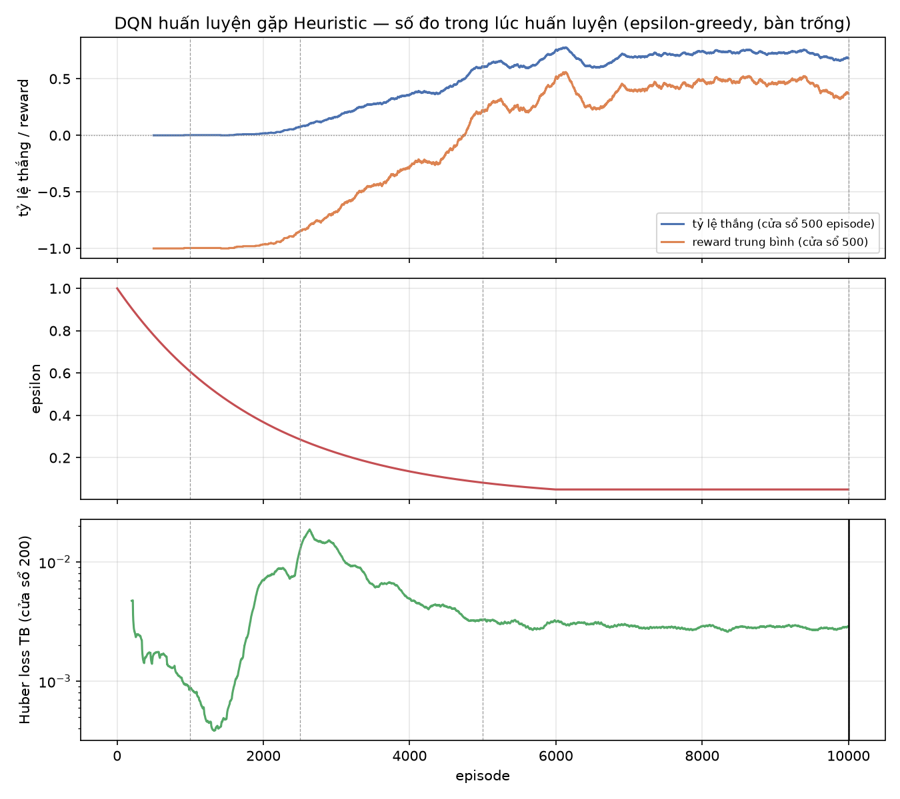
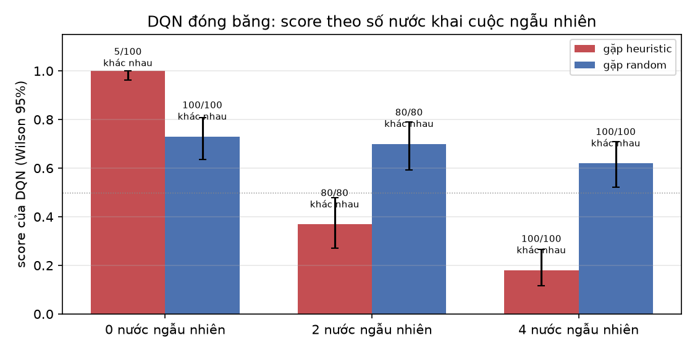

# 4.4. DQN cấp 6: đường cong học, validation và checkpoint đóng băng

Số liệu: `checkpoints/level6_dqn/final.json`, `results/logs/train_dqn_a4-default_decay-s0-20261118T155757Z.csv`,
`results/tables/dqn_opening_diagnostic.csv`; hình tạo từ `notebooks/01_dqn_analysis.ipynb`.

## Quy tắc chọn checkpoint (đăng ký trước)

Chọn mốc có điểm validation trung bình (Random và Heuristic, 100 ván mỗi đối thủ, seed 20261102/20261103, DQN greedy) cao nhất trong 4 mốc 1.000 / 2.500 / 5.000 / 10.000 episode của ô `default_decay` seed 0; hòa thì chọn mốc sớm hơn. Seed giải đấu không được dùng để chọn.

<!-- TABLE:dqn_validation -->
| Mốc episode | score vs Random (T–H–B) | score vs Heuristic (T–H–B) | Điểm chọn mốc (trung bình) |
| ---: | ---: | ---: | ---: |
| 1.000 | 0,59 (59-0-41) | 0,01 (1-0-99) | 0,300 |
| 2.500 | 0,56 (56-0-44) | 0,05 (5-0-95) | 0,305 |
| 5.000 | 0,55 (55-0-45) | 0,07 (7-1-92) | 0,312 |
| 10.000 | 0,63 (63-0-37) | 0,12 (12-0-88) | 0,375 ← chọn |
<!-- /TABLE:dqn_validation -->

Mốc được chọn: **10.000 episode** (validation trung bình 0,375). `final.pt` chỉ chứa trọng số (~1,5 MB); metadata, sha256 và commit nằm trong `final.json`.

**Ghi chú về thời điểm:** việc đóng băng được thực hiện ngày 18/11/2026, muộn hơn mốc 17/11 trong kế hoạch, do ô A4 đầu tiên mất ~30 phút CPU mỗi ô và các tiến trình nền bị mất khi phiên làm việc trước kết thúc phải chạy lại.

Lần chạy chính (ô A4 `default_decay` seed 0) đến mốc 10.000 episode thực hiện 94.696 lần cập
nhật optimizer trong khoảng 1.564 giây CPU (khoảng 26 phút, một luồng PyTorch;
`final.json`). Suy luận khi thi đấu dưới 1 ms/nước (mục 4.3).

## Vì sao DQN yếu trước Heuristic?

DQN được huấn luyện gặp Heuristic từ bàn trống và Heuristic xác định, nên các ván huấn luyện lặp lại gần như cùng một chuỗi nước đi. Tỷ lệ thắng trong huấn luyện (≈ 0,68 ở 500 episode cuối) là số đo trên phân phối hẹp đó. Chẩn đoán `scripts/diagnose_dqn_openings.py` đo cùng checkpoint với 0, 2, 4 nước khai cuộc ngẫu nhiên:

<!-- TABLE:opening_diag -->
| Đối thủ | Nước khai cuộc ngẫu nhiên | Số ván | DQN T–H–B | score | Wilson 95% | Số ván khác nhau |
| --- | ---: | ---: | ---: | ---: | ---: | ---: |
| heuristic | 0 | 100 | 100–0–0 | 1,00 | [0,96; 1,00] | 5/100 |
| heuristic | 2 | 80 | 29–1–50 | 0,37 | [0,27; 0,48] | 80/80 |
| heuristic | 4 | 100 | 17–2–81 | 0,18 | [0,12; 0,27] | 100/100 |
| random | 0 | 100 | 73–0–27 | 0,73 | [0,64; 0,81] | 100/100 |
| random | 2 | 80 | 56–0–24 | 0,70 | [0,59; 0,79] | 80/80 |
| random | 4 | 100 | 62–0–38 | 0,62 | [0,52; 0,71] | 100/100 |
<!-- /TABLE:opening_diag -->

Từ bàn trống, DQN thắng Heuristic gần như mọi ván nhưng chỉ có vài ván phân biệt (số ván khác nhau trong bảng); với khai cuộc ngẫu nhiên, score giảm mạnh. Đây là hiện tượng **quá khớp với đường chơi cố định của đối thủ huấn luyện**, không phải lỗi mã: kiểm thử đơn vị về mặt nạ cột, Bellman target và mạng mục tiêu đều đạt. Giải đấu và validation dùng khai cuộc ngẫu nhiên nên phản ánh đúng năng lực tổng quát hơn.

Câu hỏi tiếp theo là liệu đổi cách huấn luyện, cụ thể là tự chơi hoặc gặp Random, có cho mô
hình tổng quát tốt hơn không. Thí nghiệm A6 ở mục 4.5 trả lời: trong cùng 10.000 episode,
cả hai cách đều kém hơn huấn luyện gặp Heuristic.

