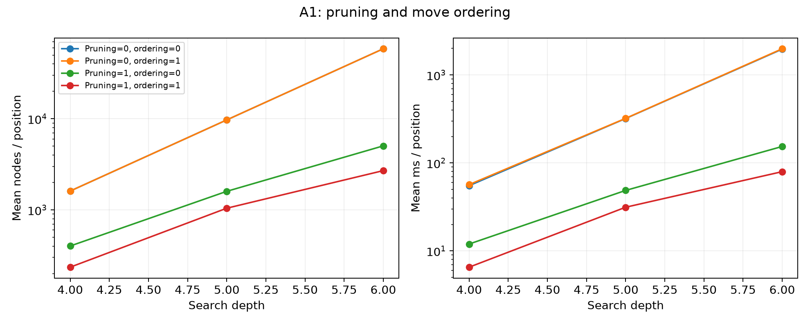
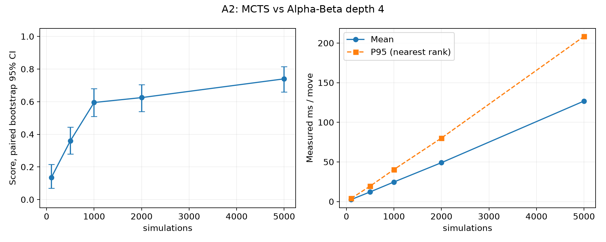
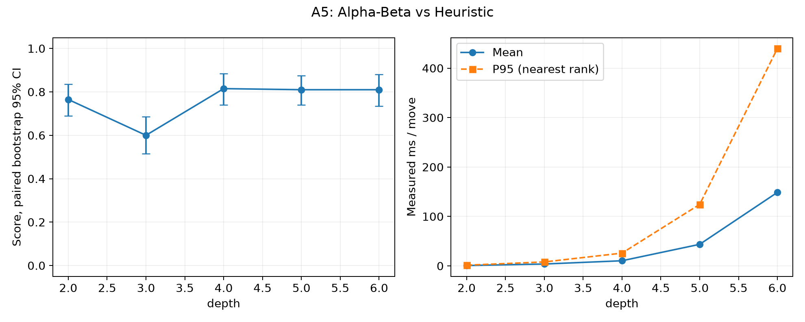

# 4.5. Ablation tìm kiếm A1, A2 và A5

Mục này khảo sát tác dụng của cắt tỉa/sắp xếp nước, ngân sách mô phỏng MCTS
và độ sâu Alpha-Beta. Các số dưới đây được đo ngày **15/11/2026, giờ Việt Nam**,
trên mã thực nghiệm commit `1b79dd5`; không phải số ước lượng. Dấu thời gian
trong `run_id` dùng UTC nên mang ngày 14/11. Đây là bộ số hiện có, chưa tự coi
là bộ đóng băng toàn nhóm ngày 19/11.

## Thiết kế và khả năng truy vết

- Máy chạy: CPU ARM, RAM 16 GB, Darwin 25.6.0; Python 3.13.7, NumPy 2.5.4.
  Các tác tử tìm kiếm dùng CPU, không dùng GPU hay mạng nơ-ron.
- Chạy lần lượt A1, A5, A2; không chạy đồng thời các thí nghiệm này. Thời gian
  là thời gian thực đo trên máy, chịu ảnh hưởng của tải nền và môi trường.
- Bộ `tests/data/positions.csv` có 31 thế: 30 thế còn chơi được và một bàn hòa
  đã đầy. Bàn kết thúc được lưu với trạng thái `excluded_terminal`, không
  đưa vào trung bình thời gian hoặc số nút của thao tác chọn nước.
- A1: ba độ sâu × bốn tổ hợp cắt tỉa/sắp xếp × 30 thế × năm lần lặp, tổng
  1.800 lần đo hợp lệ. A5: năm độ sâu × 30 thế × ba lần lặp, tổng 450 lần đo.
- A2 và phần đối đầu A5: mỗi mức 100 ván, gồm 50 khai cuộc khác nhau dài bốn
  nước, mỗi khai cuộc chơi hai lần đổi bên. Toàn bộ gồm 1.000 ván.
- Seed khai cuộc là `20261104`; seed tác tử ngẫu nhiên trong ván có chỉ số
  `i` là `20261104 + i`. Mỗi mức dùng lại cùng bộ khai cuộc và lịch seed.
  Đây là một cohort khai cuộc với nhiều luồng RNG theo ván, không phải nhiều
  lần lặp độc lập của cả thí nghiệm.
- Mọi ván được phát lại bằng `ReferenceGame` trước khi chấp nhận kết quả;
  chương trình kiểm tra MCTS thực hiện đúng số mô phỏng ở mỗi nước.

Score được tính bằng `(thắng + 0,5 × hòa) / số ván`. Trung bình và p95 độ trễ
được tính trên từng nước của tác tử khảo sát; p95 dùng nearest-rank, không
lấy trung bình các p95 theo ván. Khoảng tin cậy (CI) 95% của score dùng
bootstrap 10.000 lần trên **50 cặp khai cuộc**, giữ hai ván đổi bên trong cùng
một đơn vị lấy mẫu. Cột Wilson trong CSV chỉ là tham khảo cho tỷ lệ thắng;
không dùng giả định độc lập từng ván để thay CI theo cặp.

Các bảng có tên cố định phục vụ notebook; bản gắn `run_id` và log thô được giữ
để truy vết. Mọi số tổng hợp chính dưới đây có dòng tương ứng trong
[`report_numbers.csv`](../../results/tables/report_numbers.csv).

| Thí nghiệm | Run ID | Nguồn |
| --- | --- | --- |
| A1 | ablation-a1-20261114T172315Z-s20261104 | `results/tables/ablation_a1_results.csv` |
| A2 | ablation-a2-20261114T173956Z-s20261104 | `results/tables/ablation_a2_results.csv` |
| A5 | ablation-a5-20261114T173556Z-s20261104 | `results/tables/ablation_a5_results.csv` |

## A1 — Ảnh hưởng của cắt tỉa và sắp xếp nước

Giữ nguyên thế cờ, độ sâu và hàm lượng giá. Sắp xếp bật dùng thứ tự ưu tiên
trung tâm của dự án. Hai công tắc được thay đổi độc lập.

| Độ sâu | Cắt tỉa | Sắp xếp | Nút trung bình/thế | ms trung bình/thế | p95 (ms) |
| --- | --- | --- | --- | --- | --- |
| 4 | Bật | Bật | 235,0 | 6,53 | 31,58 |
| 4 | Bật | Tắt | 401,3 | 11,97 | 35,55 |
| 4 | Tắt | Bật | 1609,8 | 56,69 | 98,27 |
| 4 | Tắt | Tắt | 1609,8 | 55,13 | 98,63 |
| 5 | Bật | Bật | 1042,8 | 31,36 | 141,15 |
| 5 | Bật | Tắt | 1598,1 | 48,71 | 159,61 |
| 5 | Tắt | Bật | 9714,4 | 321,22 | 689,12 |
| 5 | Tắt | Tắt | 9714,4 | 319,81 | 684,30 |
| 6 | Bật | Bật | 2697,1 | 79,57 | 411,42 |
| 6 | Bật | Tắt | 5042,0 | 153,84 | 631,51 |
| 6 | Tắt | Bật | 58678,0 | 1984,02 | 4773,42 |
| 6 | Tắt | Tắt | 58678,0 | 1964,87 | 4909,62 |

Ở độ sâu 6, bật cả hai công tắc giảm số nút trung bình từ
58678,0 xuống 2697,1, tương ứng **95,40%**.
Thời gian trung bình giảm từ 1964,87 xuống 79,57 ms,
tức nhanh hơn khoảng **24,69 lần** trên bộ thế và máy này.

Khi tắt cắt tỉa, bật sắp xếp không thay đổi số nút: toàn bộ cây giới hạn độ sâu
vẫn được duyệt. Chênh lệch thời gian nhỏ giữa hai cấu hình không cắt tỉa không
được diễn giải thành thay đổi độ phức tạp. Khi có cắt tỉa, thứ tự tốt giúp tạo
cận sớm hơn và giảm số nhánh phải duyệt.

Tất cả lần đo cho cùng giá trị minimax tại cùng thế/độ sâu. **Không yêu cầu
cùng cột khi nhiều nước hòa điểm**: thuật toán giữ nước duyệt trước, nên thay
thứ tự có thể đổi cột mà vẫn giữ cùng giá trị tối ưu theo hàm lượng giá. Kết
quả này không chứng minh tác tử chơi tối ưu toàn bộ Connect Four.

## A2 — Ngân sách mô phỏng MCTS

Giữ đối thủ Alpha-Beta độ sâu 4, cắt tỉa/sắp xếp bật, rollout ngẫu nhiên và
hệ số UCT mặc định `c=1.414`. Chỉ thay số mô phỏng.

| Mô phỏng/nước | Thắng–hòa–thua | Score | CI 95% theo cặp | ms/nước | p95 (ms) |
| --- | --- | --- | --- | --- | --- |
| 100 | 12–3–85 | 0,135 | [0,070; 0,215] | 2,54 | 3,96 |
| 500 | 34–4–62 | 0,360 | [0,280; 0,445] | 12,22 | 19,53 |
| 1000 | 57–5–38 | 0,595 | [0,510; 0,680] | 24,72 | 40,47 |
| 2000 | 60–5–35 | 0,625 | [0,540; 0,705] | 49,08 | 80,13 |
| 5000 | 72–4–24 | 0,740 | [0,660; 0,815] | 126,82 | 208,37 |

Trên cohort này, score tăng từ 0,135 lên 0,740 khi tăng 100 lên 5.000 mô phỏng,
đồng thời thời gian trung bình tăng từ 2,54 lên 126,82 ms/nước. Ở mức 500 mô
phỏng MCTS vẫn thua Alpha-Beta sâu 4 nhiều hơn thắng; kết quả thắng Random
cao của K3 vì vậy không đủ để suy ra thắng trước đối thủ tìm kiếm.

Mức 1.000 và 2.000 có score lần lượt 0,595 và 0,625, các CI còn chồng lấn.
Không khẳng định chênh lệch nhỏ này có ý nghĩa thống kê chỉ từ điểm trung bình;
muốn kết luận về chênh lệch giữa các mức cần phân tích hiệu số ghép cặp và
lặp thêm cohort. Việc tăng mô phỏng có ích trong phép thử này, nhưng không
bảo đảm lợi ích tuyến tính hoặc thắng mọi đối thủ.

**A2 không phải phép so sánh cùng thời gian.** Alpha-Beta cố định độ sâu,
MCTS cố định số mô phỏng; số nút và số rollout không phải đơn vị chi phí
có thể quy đổi trực tiếp. Vì vậy A2 cung cấp một phần bằng chứng cho RQ1,
chưa thay thế giải đấu cùng thời gian mỗi nước.

## A5 — Độ sâu Alpha-Beta

Bật cắt tỉa và sắp xếp ở mọi độ sâu. Phần đối đầu giữ Heuristic làm đối thủ;
không dùng kết quả các ván này để chọn cấu hình rồi gọi lại chúng là tập test
độc lập.

| Độ sâu | Thắng–hòa–thua | Score | CI 95% theo cặp | ms/nước | p95 (ms) |
| --- | --- | --- | --- | --- | --- |
| 2 | 72–9–19 | 0,765 | [0,690; 0,835] | 0,75 | 1,44 |
| 3 | 57–6–37 | 0,600 | [0,515; 0,685] | 3,78 | 8,02 |
| 4 | 79–5–16 | 0,815 | [0,740; 0,885] | 10,42 | 25,83 |
| 5 | 79–4–17 | 0,810 | [0,740; 0,875] | 43,64 | 124,39 |
| 6 | 80–2–18 | 0,810 | [0,735; 0,880] | 148,71 | 439,88 |

Đo riêng trên bộ thế cờ (ba lần lặp/thế):

| Độ sâu | Nút trung bình/thế | ms trung bình/thế | p95 (ms) |
| --- | --- | --- | --- |
| 2 | 23,0 | 0,58 | 1,37 |
| 3 | 93,0 | 2,58 | 6,91 |
| 4 | 235,0 | 6,12 | 28,19 |
| 5 | 1042,8 | 29,65 | 137,70 |
| 6 | 2697,1 | 73,41 | 374,00 |

Tăng độ sâu làm chi phí tăng rõ, nhưng sức mạnh **không tăng đơn điệu**:
score độ sâu 3 là 0,600, thấp hơn 0,765 ở độ sâu 2. Các mức 4/5/6 lần lượt
đạt 0,815/0,810/0,810, trong khi thời gian trung bình tăng từ 10,42 lên
148,71 ms/nước từ sâu 4 đến sâu 6. Bộ thử này chưa cho thấy lợi ích score rõ
khi vượt sâu 4 trước Heuristic.

Khác biệt chẵn/lẻ của điểm dừng tìm kiếm, sai số hàm lượng giá và tác động
của khai cuộc là các giả thuyết cần kiểm tra để giải thích kết quả sâu 3.
Chưa thực hiện thí nghiệm tách riêng từng nguyên nhân, nên không khẳng định
đã xác định nguyên nhân. Kiểm thử đối chiếu minimax và A1 bảo đảm những tính
chất được kiểm tra, không bảo đảm lượng giá ở mọi độ sâu phản ánh đúng sức
mạnh thực chiến. Giữ lại kết quả bất lợi thay vì bỏ mức sâu 3.

## Giới hạn và kết luận

A1 cho thấy cắt tỉa và thứ tự duyệt giảm chi phí trong khi giữ giá trị tìm
kiếm. A2 cho thấy ngân sách mô phỏng ảnh hưởng mạnh đến kết quả trước đối thủ
cố định. A5 cho thấy tăng chi phí tìm kiếm chưa chắc cải thiện score trong
một tập thử hữu hạn. Ba kết quả phải được đọc cùng thiết kế và đối thủ cụ thể.

Giới hạn: bộ thế chỉ có 30 trạng thái hoạt động; chỉ một cohort khai cuộc;
thứ tự đo cố định và chưa kiểm soát nhiệt độ/tải hệ điều hành; năm lần lặp
A1 không phải năm mẫu thế cờ độc lập; các CI score không bao phủ mọi nguồn
bất định khi đổi bộ khai cuộc hoặc đối thủ. Các bảng không thay cho giải đấu
đầy đủ sáu tác tử hoặc chế độ cùng thời gian. Kết luận suy rộng sang trò chơi
khác chỉ là hướng nghiên cứu.

Tái lập: xem [hướng dẫn A1/A2/A5](../SEARCH_ABLATIONS.md) và
[notebook phân tích](../../notebooks/03_search_ablations.ipynb). Notebook kiểm
tra lại bảng từ log thô trước khi dựng hình và cập nhật số liệu báo cáo.
