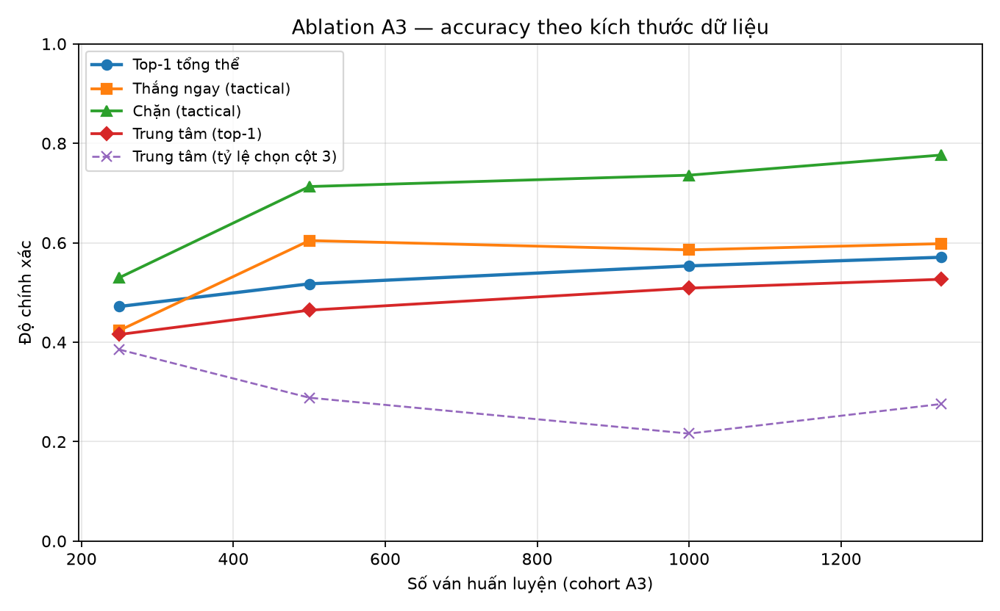

# 4.5. Ablation A3 — ảnh hưởng của kích thước dữ liệu huấn luyện

> **Trạng thái số liệu (bản nháp).** Mục này dùng bảng
> `results/tables/ablation_a3_results.csv` và các log ngày 11/11/2026. Theo
> Issue #41, số liệu cuối phải lấy từ bộ đóng băng 19/11/2026 22:00; trước khi
> merge cần đối chiếu lại và cập nhật `results/tables/report_numbers.csv` nếu
> bộ đóng băng thay đổi.

Ablation A3 trả lời trực tiếp RQ2 ở khía cạnh dữ liệu: **khi tăng số ván huấn
luyện, CNN Policy cải thiện top-1 và độ chính xác theo tình huống chiến thuật
như thế nào?** Mục này trình bày thiết kế, kết quả, phân tích và giới hạn của
thí nghiệm.

## 4.5.1. Câu hỏi và thiết kế

### Biến được thay đổi

A3 chỉ thay đổi **số ván train** lấy từ cohort `a3`. Các yếu tố khác được giữ
nguyên:

| Thành phần | Giá trị |
| --- | --- |
| Kiến trúc | `CNNPolicyNet`, 2 kênh vào, 64 kênh ẩn, 7 logits |
| Optimizer | Adam |
| Learning rate | 1e-3 |
| Hàm mất mát | CrossEntropyLoss |
| Số epoch | 20 |
| Batch size | 64 |
| Seed | 20261105 |
| Validation | 5.070 mẫu, cố định cho cả bốn mức |
| Test | 5.012 mẫu, cố định cho cả bốn mức |

Bốn mức dữ liệu là **các tập con lồng nhau** theo thứ tự ván đã xáo trộn trong
split: 250 ⊂ 500 ⊂ 1.000 ⊂ 1.332 ván. Nhờ vậy mức nhỏ là tập con thực sự của
mức lớn, không phải bốn tập ngẫu nhiên độc lập.

### Vì sao dừng ở 1.332 ván?

Cohort `a3` có 2.000 ván, nhưng sau khi chia theo ván 70/15/15 và loại trạng
thái trùng/đối xứng, chỉ còn 1.332 ván train có mẫu duy nhất. Mức 2.000 không
khả thi nếu giữ nguyên quy trình chia và khử trùng lặp. Vì vậy cấu hình dùng
`[250, 500, 1000, 1332]`, trong đó 1.332 là mức tối đa thực có.

| Ván train | Mẫu train | Ván validation | Mẫu validation | Mẫu test |
| ---: | ---: | ---: | ---: | ---: |
| 250 | 10.857 | 254 | 5.070 | 5.012 |
| 500 | 21.098 | 254 | 5.070 | 5.012 |
| 1.000 | 40.561 | 254 | 5.070 | 5.012 |
| 1.332 | 53.284 | 254 | 5.070 | 5.012 |

Nguồn: `results/tables/ablation_a3_results.csv`; `ablation_run_id =
ablation-a3-20261111T150514Z-s20261105`.

## 4.5.2. Kết quả tổng hợp

| Ván train | Epoch tốt nhất | Val loss | Test loss | Top-1 | Thắng ngay (tactical) | Chặn (tactical) | Trung tâm (top-1) | Trung tâm (cột 3) | Thời gian (s) |
| ---: | ---: | ---: | ---: | ---: | ---: | ---: | ---: | ---: | ---: |
| 250 | 3 | 1,38322 | 1,39591 | 47,19% | 42,37% | 52,99% | 41,55% | 38,51% | 18,48 |
| 500 | 7 | 1,28302 | 1,30884 | 51,74% | 60,44% | 71,30% | 46,44% | 28,83% | 34,47 |
| 1.000 | 5 | 1,16367 | 1,15892 | 55,35% | 58,57% | 73,59% | 50,87% | 21,62% | 53,17 |
| 1.332 | 5 | 1,11502 | 1,11058 | 57,08% | 59,81% | 77,64% | 52,65% | 27,57% | 66,73 |

Nguồn: `results/tables/ablation_a3_results.csv`; log từng epoch tại
`results/logs/train_cnn_<run_id>.csv`. Nhật ký thí nghiệm chi tiết nằm trong
`docs/EXPERIMENT_LOG.md`, mục `ablation-a3-20261111T150514Z-s20261105` (được bổ
sung cùng PR #70); nếu mục này chưa có trên nhánh hiện tại thì nguồn chuẩn vẫn là
bảng và log nêu trên. Tỷ lệ dự đoán hợp lệ là 100% ở cả bốn mức.

**Hình 4.5.1.** Top-1 tổng thể và độ chính xác theo tình huống khi tăng số ván
train. Đường "Trung tâm (tỷ lệ chọn cột 3)" là chỉ số chẩn đoán, không phải
thước đo sức mạnh. Hình do `notebooks/02_cnn_analysis.ipynb` sinh từ bảng A3.

### Mẫu số của từng tình huống

Vì validation/test cố định, số vị trí mỗi tình huống không đổi giữa bốn mức:

| Tình huống | Số vị trí test | Tỷ lệ |
| --- | ---: | ---: |
| `win_now` | 321 | 6,40% |
| `block` | 568 | 11,33% |
| `center_control` | 3.090 | 61,65% |
| `other` | 1.033 | 20,61% |
| **Tổng** | **5.012** | **100%** |

## 4.5.3. Phân tích

### Xu hướng tổng thể

- **Top-1 tăng đơn điệu:** 47,19% → 51,74% → 55,35% → 57,08%, tức tăng
  9,90 điểm phần trăm từ 250 lên 1.332 ván.
- **Test loss giảm đơn điệu:** 1,39591 → 1,30884 → 1,15892 → 1,11058, giảm
  0,28533.
- **Chặn là tình huống cải thiện mạnh nhất:** độ chính xác tactical tăng từ
  52,99% lên 77,64% (24,65 điểm phần trăm). Đây là tín hiệu quan trọng vì bỏ
  sót nước chặn thường dẫn tới thua ngay.
- **Thắng ngay cải thiện nhưng không đơn điệu:** 42,37% → 60,44% → 58,57% →
  59,81%. Mức 500 ván đạt 60,44%, cao hơn mức 1.332 ván (59,81%).
- **Kiểm soát trung tâm (top-1) tăng:** 41,55% → 52,65% (11,10 điểm phần trăm).

### Lợi ích biên theo từng bước

| Bước | Top-1 | Thắng ngay (tactical) | Chặn (tactical) | Trung tâm (top-1) | Test loss |
| --- | ---: | ---: | ---: | ---: | ---: |
| 250 → 500 | +4,55 | +18,07 | +18,31 | +4,89 | −0,0871 |
| 500 → 1.000 | +3,61 | −1,87 | +2,29 | +4,43 | −0,1499 |
| 1.000 → 1.332 | +1,74 | +1,25 | +4,05 | +1,78 | −0,0483 |
| **250 → 1.332** | **+9,90** | **+17,45** | **+24,65** | **+11,10** | **−0,2853** |

Đơn vị: điểm phần trăm, riêng test loss là đơn vị loss.

Hai quan sát:

1. **Lợi ích lớn nhất nằm ở bước 250 → 500.** Chỉ thêm 250 ván nhưng top-1
   tăng 4,55 điểm phần trăm, chặn tăng 18,31 và thắng ngay tăng 18,07. Đây là
   vùng dữ liệu còn thiếu nhiều, mô hình học được các mẫu chiến thuật cơ bản.
2. **Lợi ích biên giảm dần, trừ tình huống chặn.** Từ 1.000 lên 1.332 ván,
   top-1 chỉ tăng 1,74 điểm phần trăm nhưng chặn vẫn tăng 4,05. Điều này cho
   thấy dữ liệu bổ sung chủ yếu giúp các tình huống chặn, trong khi top-1 tổng
   thể gần bão hòa.

### Chỉ số trung tâm cần đọc đúng

Có hai cách đo liên quan tới cột trung tâm:

- **`center_control_top1_accuracy`:** dự đoán trùng nhãn Alpha-Beta trong các
  vị trí `center_control`. Chỉ số này tăng từ 41,55% lên 52,65%.
- **`center_control_situation_accuracy`:** tỷ lệ dự đoán đúng **cột 3**. Chỉ số
  này giảm từ 38,51% xuống 27,57% (giảm 10,94 điểm phần trăm).

Hai chỉ số đi ngược chiều không phải mâu thuẫn. Nhãn Alpha-Beta độ sâu 4 không
luôn chọn cột 3 khi không có nước thắng/chặn tức thời; khi có thêm dữ liệu, mô
hình bắt chước nhãn Alpha-Beta sát hơn, nên tỷ lệ chọn cột 3 giảm dù độ khớp
nhãn tăng. Vì vậy chỉ số "chọn cột 3" chỉ là chẩn đoán, không dùng để kết luận
mô hình yếu đi.

## 4.5.4. Nhiễu nhãn và cách diễn giải tình huống thắng ngay

Trong 321 vị trí `win_now` của tập test, **98 nhãn Alpha-Beta (30,53%) không
phải nước thắng ngay**. Nói cách khác, chuyên gia sinh nhãn bỏ lỡ nước thắng
tức thời ở gần một phần ba số vị trí. Vì vậy:

- **Top-1 của `win_now`** (64,80% → 71,96% → 71,96% → 70,72%) đo mức khớp nhãn,
  kể cả khi nhãn sai.
- **Tactical accuracy của `win_now`** (42,37% → 60,44% → 58,57% → 59,81%) đo
  việc dự đoán có nằm trong tập nước thắng ngay hay không. Đây mới là thước đo
  đúng cho năng lực chiến thuật ở nhóm này.

Top-1 cao hơn tactical accuracy là hệ quả trực tiếp của nhiễu nhãn: mô hình
được tính đúng khi khớp một nhãn không thắng ngay, trong khi tactical accuracy
không cho điểm cho trường hợp đó. Báo cáo dùng tactical accuracy làm chỉ số
chính cho `win_now`, và ghi rõ top-1 chỉ để tham khảo.

Với `block`, nhãn và tập nước chặn gần như trùng nhau; ở mức 1.332 ván, block
top-1 và block tactical cùng bằng 77,64%. Với `other`, không có luật chiến thuật
đặc biệt nên top-1 và situation accuracy trùng nhau (50,44% → 54,79%).

## 4.5.5. Giới hạn

- **Một seed:** toàn bộ A3 dùng seed 20261105. Chưa có khoảng tin cậy hay lặp
  seed, nên chênh lệch nhỏ (ví dụ 1,74 điểm phần trăm top-1 ở bước cuối) chưa
  thể coi là khác biệt có ý nghĩa thống kê.
- **Một cách chia dữ liệu:** validation/test cố định giúp so sánh công bằng
  nhưng kết quả có thể phụ thuộc split.
- **Test nhỏ:** 5.012 mẫu đến từ 264 ván; một số tình huống chỉ có 321 hoặc 568
  vị trí, nên tỷ lệ phần trăm dao động đáng kể khi đổi tập test.
- **Trần dữ liệu 1.332 ván:** không thể khảo sát mức lớn hơn nếu giữ quy trình
  chia và khử trùng lặp hiện tại.
- **Chưa đo sức mạnh đối kháng:** A3 chỉ đo loss, top-1 và accuracy theo tình
  huống. Chưa có win rate trước Alpha-Beta/MCTS, nên không thể kết luận mô hình
  mạnh hơn tác tử tìm kiếm.
- **Nhãn phụ thuộc Alpha-Beta độ sâu 4:** mô hình bị giới hạn bởi chuyên gia
  sinh nhãn; top-1 cao không chứng minh mô hình vượt chuyên gia.
- **Chỉ CPU, một kiến trúc:** chưa khảo sát độ rộng mạng, regularization hay
  learning rate schedule.
- **Số liệu chưa đóng băng:** cần đối chiếu lại với bộ đóng băng 19/11/2026
  22:00 trước khi merge.

## 4.5.6. Kết luận mục

Ablation A3 cho thấy tăng dữ liệu huấn luyện cải thiện rõ rệt chất lượng CNN
Policy: top-1 tăng 9,90 điểm phần trăm, chặn tăng 24,65, thắng ngay tăng 17,45
và test loss giảm 0,28533 khi đi từ 250 lên 1.332 ván. Phần lớn lợi ích đến từ
bước 250 → 500; các bước sau có lợi ích biên giảm dần, riêng tình huống chặn
vẫn tiếp tục cải thiện. Tuy nhiên, thắng ngay không đơn điệu và toàn bộ thí
nghiệm chỉ chạy một seed, nên kết luận cần được kiểm chứng thêm bằng lặp seed
và đánh giá đối kháng ở giai đoạn giải đấu.

## Checklist trước khi merge

- [ ] Đối chiếu lại toàn bộ số trong mục 4.4 và 4.5 với bộ số đóng băng
      19/11/2026 22:00.
- [ ] Cập nhật `results/tables/report_numbers.csv` nếu bộ đóng băng thay đổi.
- [ ] Xác nhận `cnn_main_learning_curve.png`, `ablation_a3_learning_curves.png`
      và `ablation_a3_accuracy.png` khớp log đóng băng.
- [ ] Chạy `pytest -q` xanh sau mọi thay đổi mã nguồn.
