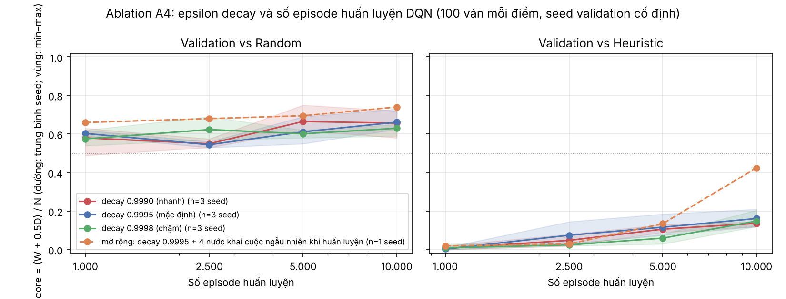
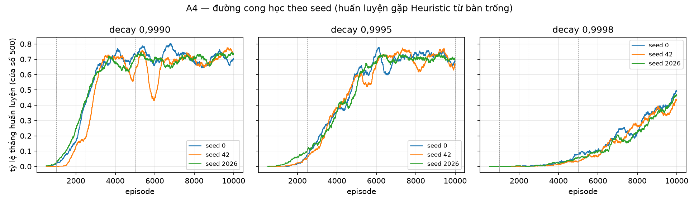
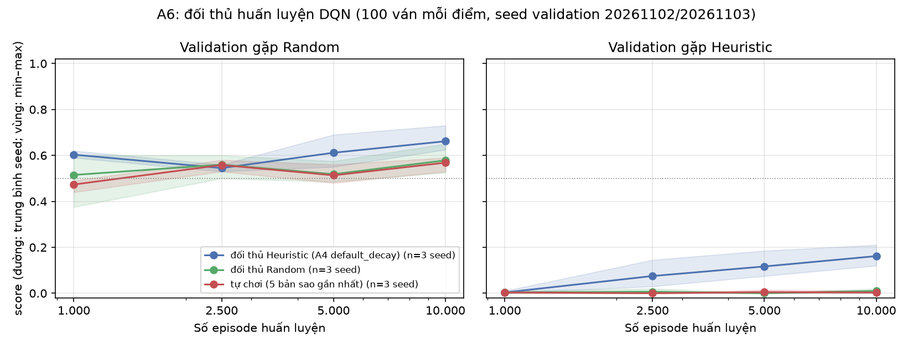
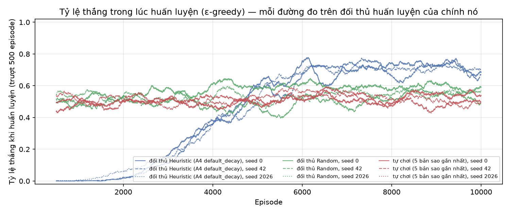

# 4.5. Ablation A4: lịch giảm epsilon × seed

Cấu hình: `configs/ablation_a4_dqn_training.yaml`. Ba mức decay theo episode (0,9990 / 0,9995 / 0,9998), ba seed (0, 42, 2026), 10.000 episode mỗi ô, đánh giá tại 1.000 / 2.500 / 5.000 / 10.000 episode với 100 ván/đối thủ trên seed validation cố định. Chạy ngày 18/11/2026; 9 ô, mỗi ô ~18–31 phút CPU. Bảng gốc: `results/tables/ablation_a4_results.csv`, tổng hợp: `results/tables/ablation_a4_summary.csv`.

## Kết quả chính (trung bình ± độ lệch chuẩn giữa 3 seed)

<!-- TABLE:a4_main -->
**Validation gặp Random** — score trung bình ± độ lệch chuẩn mẫu giữa các seed, [min–max]; mỗi điểm 100 ván/seed.

| Epsilon decay | 1.000 ep | 2.500 ep | 5.000 ep | 10.000 ep |
| --- | ---: | ---: | ---: | ---: |
| 0,9990 (nhanh) | 0,58 ± 0,08 [0,49–0,63] | 0,55 ± 0,02 [0,53–0,57] | 0,67 ± 0,07 [0,62–0,75] | 0,66 ± 0,07 [0,58–0,72] |
| 0,9995 (mặc định) | 0,60 ± 0,02 [0,59–0,62] | 0,55 ± 0,01 [0,53–0,56] | 0,61 ± 0,07 [0,55–0,69] | 0,66 ± 0,06 [0,62–0,73] |
| 0,9998 (chậm) | 0,57 ± 0,04 [0,54–0,62] | 0,62 ± 0,06 [0,57–0,69] | 0,60 ± 0,02 [0,58–0,62] | 0,63 ± 0,03 [0,59–0,65] |

**Validation gặp Heuristic** — score trung bình ± độ lệch chuẩn mẫu giữa các seed, [min–max]; mỗi điểm 100 ván/seed.

| Epsilon decay | 1.000 ep | 2.500 ep | 5.000 ep | 10.000 ep |
| --- | ---: | ---: | ---: | ---: |
| 0,9990 (nhanh) | 0,01 ± 0,01 [0,00–0,02] | 0,05 ± 0,03 [0,02–0,08] | 0,11 ± 0,02 [0,09–0,13] | 0,14 ± 0,01 [0,12–0,14] |
| 0,9995 (mặc định) | 0,00 ± 0,01 [0,00–0,01] | 0,07 ± 0,06 [0,03–0,14] | 0,12 ± 0,06 [0,07–0,18] | 0,16 ± 0,05 [0,12–0,21] |
| 0,9998 (chậm) | 0,01 ± 0,02 [0,00–0,03] | 0,03 ± 0,01 [0,02–0,03] | 0,06 ± 0,03 [0,03–0,08] | 0,15 ± 0,05 [0,12–0,20] |
<!-- /TABLE:a4_main -->

<!-- TABLE:a4_seeds -->
| Cấu hình | Seed | vs Random T–H–B | score | vs Heuristic T–H–B | score | Tỷ lệ thắng huấn luyện (500 ep cuối) | Thời gian huấn luyện (s) |
| --- | ---: | ---: | ---: | ---: | ---: | ---: | ---: |
| fast_decay | 0 | 67–0–33 | 0,67 | 14–1–85 | 0,14 | 0,70 | 1 929 |
| fast_decay | 42 | 72–0–28 | 0,72 | 12–0–88 | 0,12 | 0,73 | 1 920 |
| fast_decay | 2026 | 58–0–42 | 0,58 | 14–1–85 | 0,14 | 0,73 | 1 785 |
| default_decay | 0 | 63–0–37 | 0,63 | 12–0–88 | 0,12 | 0,68 | 1 564 |
| default_decay | 42 | 73–0–27 | 0,73 | 20–2–78 | 0,21 | 0,67 | 1 858 |
| default_decay | 2026 | 62–1–37 | 0,62 | 15–1–84 | 0,15 | 0,70 | 1 729 |
| slow_decay | 0 | 65–0–35 | 0,65 | 12–0–88 | 0,12 | 0,49 | 1 086 |
| slow_decay | 42 | 65–0–35 | 0,65 | 20–1–79 | 0,20 | 0,43 | 1 112 |
| slow_decay | 2026 | 59–0–41 | 0,59 | 12–0–88 | 0,12 | 0,46 | 1 063 |
<!-- /TABLE:a4_seeds -->

## Nhận xét

- Ở 10.000 episode, score trước Heuristic là 0,137 (decay 0,9990), 0,162 (0,9995) và 0,148 (0,9998); độ lệch chuẩn giữa seed 0,014–0,049. Các khác biệt giữa ba mức decay **nhỏ hơn hoặc ngang** dao động giữa seed, nên với 3 seed chưa kết luận mức decay nào tốt hơn.
- Trước Random, score 0,657 / 0,662 / 0,630 (cũng trong dao động giữa seed).
- Decay chậm nhất (0,9998) còn epsilon 0,135 ở episode 10.000 nên tỷ lệ thắng *trong lúc huấn luyện* thấp hơn (do còn khám phá), nhưng điểm đánh giá greedy tương đương.
- Không cấu hình nào đạt kết quả tốt trước Heuristic trong đánh giá khai cuộc ngẫu nhiên; nguyên nhân chính là điều kiện huấn luyện (xem 4.4), không phải mức decay.

## Ô mở rộng sau chẩn đoán (không thuộc A4 gốc)

Sau khi thấy kết quả chẩn đoán ở 4.4, chạy thêm **một** ô `default_decay` seed 0 với 4 nước khai cuộc ngẫu nhiên mỗi episode (`--opening-plies 4`). Ô này không dùng để chọn checkpoint giải đấu (đã đóng băng trước) và chỉ có một seed.

<!-- TABLE:a4_extension -->
| Mốc episode | Đối thủ | T–H–B (mở rộng, 4 nước ngẫu nhiên) | score | Wilson 95% | T–H–B (A4 gốc, seed 0) | score (A4 gốc) |
| ---: | --- | ---: | ---: | ---: | ---: | ---: |
| 1.000 | heuristic | 2–0–98 | 0,02 | [0,01; 0,07] | 1–0–99 | 0,01 |
| 1.000 | random | 66–0–34 | 0,66 | [0,56; 0,75] | 59–0–41 | 0,59 |
| 2.500 | heuristic | 3–0–97 | 0,03 | [0,01; 0,08] | 5–0–95 | 0,05 |
| 2.500 | random | 68–0–32 | 0,68 | [0,58; 0,76] | 56–0–44 | 0,56 |
| 5.000 | heuristic | 13–1–86 | 0,14 | [0,08; 0,22] | 7–1–92 | 0,07 |
| 5.000 | random | 69–1–30 | 0,69 | [0,60; 0,78] | 55–0–45 | 0,55 |
| 10.000 | heuristic | 42–1–57 | 0,42 | [0,33; 0,52] | 12–0–88 | 0,12 |
| 10.000 | random | 74–0–26 | 0,74 | [0,65; 0,82] | 63–0–37 | 0,63 |
<!-- /TABLE:a4_extension -->

Ở 10.000 episode ô mở rộng đạt score 0,425 trước Heuristic và 0,740 trước Random, so với 0,120 và 0,630 của ô A4 gốc cùng seed; cải thiện cho thấy hướng khắc phục là đa dạng hóa khai cuộc, nhưng một seed không đủ kết luận định lượng. Đề xuất cho giai đoạn sau, nếu còn thời gian: huấn luyện lại có khai cuộc ngẫu nhiên và đóng băng trước khi chạy lại giải.

## A6: đối thủ huấn luyện — Heuristic, Random hay tự chơi (mở rộng cho RQ3)

**Câu hỏi.** RQ3 hỏi DQN có tự học được qua tương tác hoặc tự chơi không, và đối thủ huấn
luyện ảnh hưởng thế nào. A4 chỉ dùng đối thủ Heuristic, nên A6 giữ nguyên mọi siêu tham số
của ô A4 `default_decay` (decay 0,9995, 10.000 episode, 3 seed 0 / 42 / 2026) và chỉ đổi
đối thủ:

- **Heuristic:** dùng lại ba ô A4 `default_decay`, không chạy lại;
- **Random:** đối thủ Random cố định;
- **Tự chơi:** đối thủ là một trong 5 bản sao đóng băng gần nhất của chính mạng, chép mới
  mỗi 500 episode, chọn nước ε-greedy cùng ε của episode (mục 3.5.4).

Đánh giá giống hệt A4 (100 ván/đối thủ/mốc, seed validation 20261102 / 20261103). Ở mốc
10.000 thêm 100 ván đấu trực tiếp với checkpoint đóng băng `final.pt` (seed 20261104) và độ
đúng trên bộ vị trí kiểm thử. Cấu hình `configs/ablation_a6_dqn_opponent.yaml`, script
`scripts/run_ablation_a6.py`, bảng `results/tables/ablation_a6_results.csv`,
`ablation_a6_summary.csv`, `ablation_a6_pooled.csv`, `ablation_a6_head_to_head.csv`,
`ablation_a6_positions.csv`. A6 chạy ngày 20/11/2026, 6 ô mới, mỗi ô khoảng 34–37 phút CPU,
**sau** khi checkpoint giải đấu đã đóng băng và giải đấu đã xong; vì vậy A6 không được dùng
để chọn checkpoint và không thay đổi mục 4.1–4.3.

<!-- TABLE:a6_main -->
**Validation gặp Random** — score trung bình ± độ lệch chuẩn mẫu giữa các seed, [min–max]; mỗi điểm 100 ván/seed.

| Đối thủ huấn luyện | 1.000 ep | 2.500 ep | 5.000 ep | 10.000 ep |
| --- | ---: | ---: | ---: | ---: |
| Heuristic (A4) (n=3) | 0,60 ± 0,02 [0,59–0,62] | 0,55 ± 0,01 [0,53–0,56] | 0,61 ± 0,07 [0,55–0,69] | 0,66 ± 0,06 [0,62–0,73] |
| Random (n=3) | 0,52 ± 0,12 [0,38–0,60] | 0,56 ± 0,05 [0,50–0,60] | 0,52 ± 0,05 [0,48–0,57] | 0,58 ± 0,06 [0,53–0,65] |
| Tự chơi (n=3) | 0,47 ± 0,03 [0,44–0,49] | 0,56 ± 0,03 [0,53–0,58] | 0,51 ± 0,04 [0,48–0,56] | 0,57 ± 0,03 [0,53–0,59] |

**Validation gặp Heuristic** — score trung bình ± độ lệch chuẩn mẫu giữa các seed, [min–max]; mỗi điểm 100 ván/seed.

| Đối thủ huấn luyện | 1.000 ep | 2.500 ep | 5.000 ep | 10.000 ep |
| --- | ---: | ---: | ---: | ---: |
| Heuristic (A4) (n=3) | 0,00 ± 0,01 [0,00–0,01] | 0,07 ± 0,06 [0,03–0,14] | 0,12 ± 0,06 [0,07–0,18] | 0,16 ± 0,05 [0,12–0,21] |
| Random (n=3) | 0,00 ± 0,01 [0,00–0,01] | 0,01 ± 0,01 [0,00–0,02] | 0,00 ± 0,00 [0,00–0,00] | 0,01 ± 0,01 [0,00–0,02] |
| Tự chơi (n=3) | 0,00 ± 0,01 [0,00–0,01] | 0,00 ± 0,00 [0,00–0,00] | 0,01 ± 0,01 [0,00–0,01] | 0,00 ± 0,01 [0,00–0,01] |
<!-- /TABLE:a6_main -->

Gộp ba seed ở mốc 10.000 episode (300 ván mỗi dòng; khoảng Wilson coi 300 ván là độc lập nên
bỏ qua phần biến thiên giữa seed và hẹp hơn khoảng thật):

<!-- TABLE:a6_pooled -->
| Đối thủ huấn luyện | Gặp | Số ván (gộp seed) | T–H–B | score | Wilson 95% |
| --- | --- | ---: | ---: | ---: | ---: |
| Heuristic (A4) | Random | 300 | 198–1–101 | 0,66 | [0,61; 0,71] |
| Heuristic (A4) | Heuristic | 300 | 47–3–250 | 0,16 | [0,12; 0,21] |
| Random | Random | 300 | 173–1–126 | 0,58 | [0,52; 0,63] |
| Random | Heuristic | 300 | 3–0–297 | 0,01 | [0,00; 0,03] |
| Random | DQN đóng băng final.pt | 300 | 117–2–181 | 0,39 | [0,34; 0,45] |
| Tự chơi | Random | 300 | 170–1–129 | 0,57 | [0,51; 0,62] |
| Tự chơi | Heuristic | 300 | 1–0–299 | 0,00 | [0,00; 0,02] |
| Tự chơi | DQN đóng băng final.pt | 300 | 124–3–173 | 0,42 | [0,36; 0,47] |
<!-- /TABLE:a6_pooled -->

Chi tiết từng seed ở mốc 10.000 (tỷ lệ thắng huấn luyện đo trên đối thủ huấn luyện của chính ô
đó, ε-greedy, nên không so được giữa các hàng):

<!-- TABLE:a6_seeds -->
| Đối thủ huấn luyện | Seed | vs Random T–H–B (score) | vs Heuristic T–H–B (score) | vs final.pt T–H–B (score) | Tỷ lệ thắng huấn luyện (500 ep cuối) | Thời gian huấn luyện (s) |
| --- | ---: | ---: | ---: | ---: | ---: | ---: |
| Heuristic (A4) | 0 | 63–0–37 (0,63) | 12–0–88 (0,12) | — (là chính final.pt) | 0,68 | 1 564 |
| Heuristic (A4) | 42 | 73–0–27 (0,73) | 20–2–78 (0,21) | — (không còn .pt) | 0,67 | 1 858 |
| Heuristic (A4) | 2026 | 62–1–37 (0,62) | 15–1–84 (0,15) | — (không còn .pt) | 0,70 | 1 729 |
| Random | 0 | 56–0–44 (0,56) | 2–0–98 (0,02) | 37–0–63 (0,37) | 0,59 | 2 076 |
| Random | 42 | 52–1–47 (0,53) | 0–0–100 (0,00) | 27–0–73 (0,27) | 0,49 | 2 113 |
| Random | 2026 | 65–0–35 (0,65) | 1–0–99 (0,01) | 53–2–45 (0,54) | 0,57 | 2 015 |
| Tự chơi | 0 | 53–0–47 (0,53) | 1–0–99 (0,01) | 42–1–57 (0,42) | 0,54 | 2 205 |
| Tự chơi | 42 | 58–1–41 (0,58) | 0–0–100 (0,00) | 41–0–59 (0,41) | 0,49 | 2 143 |
| Tự chơi | 2026 | 59–0–41 (0,59) | 0–0–100 (0,00) | 41–2–57 (0,42) | 0,49 | 2 170 |
<!-- /TABLE:a6_seeds -->

Độ đúng trên bộ vị trí kiểm thử (DQN greedy, mỗi vị trí một lần; ô Heuristic chỉ có seed 0
vì file trọng số `.pt` của hai seed còn lại không được commit):

<!-- TABLE:a6_positions -->
| Đối thủ huấn luyện | Seed | Thắng ngay | Chặn | Đòn kép | Thế yên (hợp lệ) |
| --- | ---: | ---: | ---: | ---: | ---: |
| Heuristic (A4) | 0 | 4/18 | 4/6 | 1/3 | 6/6 |
| Random | 0 | 7/18 | 1/6 | 1/3 | 6/6 |
| Random | 42 | 6/18 | 3/6 | 1/3 | 6/6 |
| Random | 2026 | 6/18 | 3/6 | 0/3 | 6/6 |
| Tự chơi | 0 | 5/18 | 3/6 | 1/3 | 6/6 |
| Tự chơi | 42 | 8/18 | 2/6 | 3/3 | 6/6 |
| Tự chơi | 2026 | 6/18 | 2/6 | 1/3 | 6/6 |
<!-- /TABLE:a6_positions -->

### Nhận xét A6

- **Tự chơi không giúp DQN trong ngân sách 10.000 episode.** Ở mốc cuối, ba mô hình tự chơi
  gặp Heuristic gần như thua hết (gộp 1–0–299, score 0,003) và gặp Random chỉ đạt score
  0,568 [0,512; 0,623], tức chỉ nhỉnh hơn mức ngẫu nhiên 0,5. Đấu trực tiếp với `final.pt`
  (huấn luyện gặp Heuristic) cả ba seed đều thua, score 0,425 / 0,410 / 0,420, gộp 0,418
  [0,363; 0,475], khoảng không chứa 0,5.
- **Đối thủ Random cũng không tốt hơn.** Gặp Heuristic 0,010 và gặp Random 0,578
  [0,522; 0,633]; đấu với `final.pt` 0,393 [0,340; 0,450], dao động giữa seed lớn
  (0,27 – 0,54).
- **Heuristic là đối thủ huấn luyện tốt nhất trong ba lựa chọn đã thử**: 0,162 gặp Heuristic
  và 0,662 [0,606; 0,713] gặp Random. Khoảng của Heuristic và của tự chơi khi gặp Random chồng
  nhau một phần, nên với Random chỉ nói được là "không kém hơn"; với Heuristic và với đấu trực
  tiếp thì chênh lệch rõ.
- **Độ đúng chiến thuật**: mô hình Random và tự chơi chọn đúng nước thắng ngay ở 5–8/18 thế,
  nhiều hơn checkpoint Heuristic (4/18), nhưng chặn đúng ít hơn (1–3/6 so với 4/6). Mẫu chỉ
  18 và 6 thế nên đây là quan sát, không phải kết luận.
- Đường cong huấn luyện của tự chơi gần như phẳng quanh 0,5: hai bên là cùng một mạng ở hai
  thời điểm gần nhau nên tỷ lệ thắng ≈ 0,5 là điều chờ đợi và **không** đo được tiến bộ; tiến
  bộ chỉ đọc được qua validation với đối thủ cố định ở bảng trên.

**Giải thích (giả thuyết, chưa kiểm chứng riêng).** Với phần thưởng chỉ ở cuối ván và ε còn
cao trong khoảng 6.000 episode đầu, cả hai bên tự chơi đều đi gần như ngẫu nhiên nên tín hiệu
học yếu. Đối thủ Heuristic trừng phạt ngay mọi nước bỏ lỡ chặn hoặc thắng, tạo nhiều ván kết
thúc sớm với phần thưởng rõ ràng hơn. Có thể cần nhiều episode hơn, lưu transition của cả hai
bên trong tự chơi, hoặc trộn tự chơi với đối thủ Heuristic; các hướng này chưa chạy.

**Kết luận A6.** Trong cấu hình đã chạy, DQN học được rất ít qua tự chơi; đối thủ huấn luyện
ảnh hưởng mạnh tới kết quả và Heuristic cho mô hình tốt nhất. Checkpoint giải đấu (gặp
Heuristic) vẫn là lựa chọn hợp lý; A6 không thay đổi lựa chọn đó.
